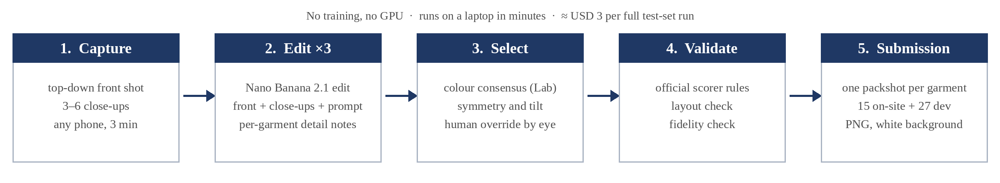
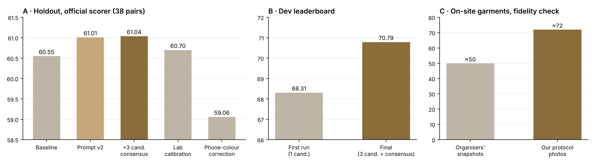
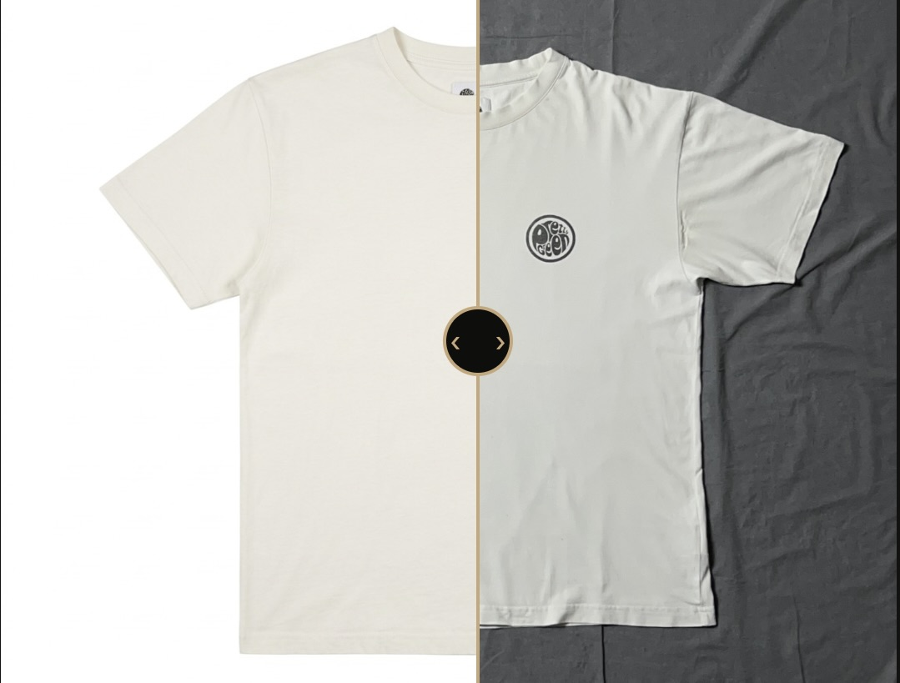

# From phone photo to packshot: capture, edit, select

**Team AACtivEtion Function** — Mohammadmahdi Ameridaragheh, Qi An, Arianna Silvestri, Eduardo Trabattoni, Andrea Gemetti.  
Sartiq challenge, Neural Wave 2026, USI Lugano, 16–18 October 2026

## 1. Problem and approach

Sartiq wants a studio flat-lay packshot of a garment from an amateur smartphone photo. The official
score compares our picture with Sartiq's studio reference: 40 % colour (global Lab distribution and a
4×4 spatial colour map), 25 % perceptual similarity (LPIPS), 15 % semantic similarity (CLIP), 15 %
silhouette overlap and 5 % structural similarity. Two things follow: colour and silhouette dominate,
and the picture must be *this* garment, not a plausible garment.

We did not train a model. Our contribution is the loop around a hosted image-editing model
(Google Nano Banana 2.1, `google/nano-banana-2.1/edit` on fal.ai):

1. **Capture protocol.** Garments are laid flat on a light surface, smoothed and made symmetric, and
   shot top-down with the phone, plus 3–6 close-ups of collar, logo, print, buttons and fabric
   (`docs/CAPTURE_PROTOCOL.md`).
2. **Multi-image edit.** One request per candidate carries the front photo *and* the close-ups with a
   fixed prompt: reproduce this exact garment as a flat-lay on white, keep colour, texture, print,
   logo and proportions. The prompt tells the model what the extra images are for. Per-garment notes
   (`garment_notes.json`) name the details that must survive ("round black-on-cream badge reading
   'Pretty Green'", "red Levi's tab on the pocket edge").
3. **Candidates and selection.** We generate three candidates per garment and pick one with a simple
   rule: the garment's median Lab colour must agree with the other candidates (colour consensus,
   because the model's colour errors are random from call to call), and the silhouette must be
   symmetric and upright (left/right mask symmetry and tilt of the principal axis). A human can
   override the pick (`manual_picks.csv`).
4. **Always submit.** For garments we could not photograph ourselves, a picture generated from the
   organisers' snapshot fills the slot.

**Figure 1.** The pipeline: capture → edit (three candidates) → select → validate → submission.

**Figure 2.** Two of the 15 on-site garments (g09, g04). From the protocol photo the model keeps the exact lay, the chest badge and the grey stone-wash; from the organisers' hanger snapshot the same model darkens the denim and invents the silhouette.

## 2. Capture protocol (what a Sartiq customer would do)

The protocol is three minutes per garment with any phone (full text in `docs/CAPTURE_PROTOCOL.md`):

1. **Surface and light.** A plain light matte surface (white table, paper, light floor); window or room
   light; flash off; no shadow of the photographer on the garment.
2. **Lay.** Front up, collar at the top; smooth from the centre outwards; sleeves at the same angle on
   both sides; placket/zip centred; buttons and zips closed; pockets and collar flattened. Heavy
   wrinkles: hands, a bottle rolled over the fabric, or a few seconds of steam.
3. **Shots.** One top-down front shot (phone parallel to the surface, garment ≈ 80 % of the frame),
   3–6 close-ups from 20–30 cm (neck label, logo/print, buttons or zip, a pocket, plain fabric), and
   optionally one back shot. Folder `captures/day1_clean/<gid>/`, best front listed in `best_fronts.csv`.

The full on-site version we shot with (6 pages, `docs/Flat-Lay_Capture_Protocol_onsite.pdf`) adds the
phone set-up (ProRAW, grid and level, 2× lens for tops and 1× for long garments, 3-second timer, flash off),
a per-garment table with background choice and exposure offset (dark garments on a light surface at +0.3
to +0.7 EV so the weave stays visible; white garments on mid grey at −0.3 to −0.7 EV), styling templates
per garment type (sleeves ≈ 15° out, cuffs level, straps up, legs parallel) and the shot list with file
names.

Why this protocol and not a more elaborate one: the model copies the lay it sees and takes colour,
texture and details from the close-ups, so the two things worth a customer's effort are a straight,
symmetric lay and sharp close-ups. Everything else (background removal, lighting, centring) the model
does well on its own. Figure 2 shows the difference the protocol makes on the same garment.

## 3. How we measured

The organisers' leaderboard gives one number per round, so we built an honest local loop first: a
38-pair holdout carved from `train/` with the official scorer (`scripts/make_holdout.py`,
`--group-by-target`). Every idea was scored there before it touched the dev set. For the 15 on-site
garments, which have no public reference, we scored each result against our own clean protocol photo
as a stand-in reference ("fidelity check"); this is not the official score, but it ranks variants of
the same garment consistently and flags shape errors.

## 4. What worked and what did not

**Figure 3.** A: every idea scored on our holdout; prompt + three-candidate consensus wins (61.04), colour correction towards the phone photo loses (59.06). B: dev leaderboard 68.31 → 70.79. C: on the 15 on-site garments, protocol photos beat the organisers' snapshots by ~20 points on the fidelity check.

Findings that shaped the final pipeline:

* **Colour errors are random, not biased.** Across garments the model's median L error is ≈ 0 with
  a mean absolute error of ~5; a constant calibration therefore gains little, and correcting towards
  the phone photo *hurts* because the phone's white balance is worse than the model's. Spatial colour
  placement is already good (0.93); the loss is in the global colour, i.e. in the garment's hue being
  slightly off. Picking the candidate that agrees with the others on colour is the cheapest way to
  reduce that variance.
* **Shape follows the input lay.** Amateur flat-lay inputs score lowest when the lay is bad, because
  the model copies it; they score highest when the lay is straight. Prompt instructions about
  geometry ("make it narrower", "straighten") *reduced* the shape score (the model redesigned the
  garment); instructions about details ("buttoned flap pocket", "red tab") improved fidelity. We kept
  the detail notes and dropped the geometry ones.
* **Close-ups matter.** With the close-ups in the request, logos and prints are reproduced instead of
  paraphrased; the fidelity check on the on-site garments moved from ~50 (organisers' snapshots) to
  ~72 (our protocol shots + close-ups), with no `review`/`invalid` flags.

On the dev leaderboard the pipeline went from 68.31 (organisers' photos, one candidate, first prompt)
to **70.79** (final prompt, three candidates, consensus selection), rank 1 at the last round we saw.
Two late experiments — per-garment detail notes for the dev set and the model's "high" thinking
level — did not beat 70.79 within noise, so the hand-in uses the 70.79 pictures.

## 5. Limitations and next steps

* The selection rule has no reference; it rewards agreement, not correctness. Three candidates is
  the minimum for a consensus; more candidates improve the odds at linear cost.
* Fine lettering is still the weakest point (small text on labels is sometimes paraphrased).
* The 10–13 point dev→test gap the organisers observed in rehearsal applies to us too; our on-site
  protocol is designed to close part of it.
* Next: a vision-model check that compares each candidate with the close-ups detail by detail
  (logo text, button count) and rejects candidates that drop a detail; a second edit pass restricted
  to the region of a wrong logo.

## 6. Tooling and reproducibility

**Review UI** (`ui/`, Gradio). Because selection is partly by eye, we built a small viewer: load the
phone photo and a packshot, a scan/reveal transition, a drag-to-reveal before/after comparison on the
same frame, and a hover magnifier up to 4× for logos, buttons and weave; a two-garment version shows
two candidates side by side. It never calls the model, so what the jury sees is exactly the hand-in.

**Figure 4.** The review UI on g09: drag the divider to reveal the packshot (left) over the phone photo (right); the chest badge and collar label can be checked at 4× with the magnifier.

**Repository** `neural-wave/ch-AACtivEtion-Functions`: `README.md` (run instructions), `pipeline.py`,
`notebooks/day2_final_pipeline_v2.ipynb` (the exact cells we ran), `docs/CAPTURE_PROTOCOL.md`,
`submissions/aactivetion_function/` (hand-in), `ui/` (Gradio demo: before/after slider and magnifier). The 2-minute video is in
`deliverables/`. Dataset and API key are not in the repository.
